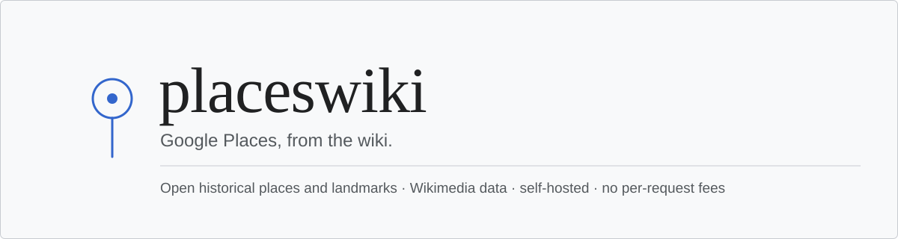
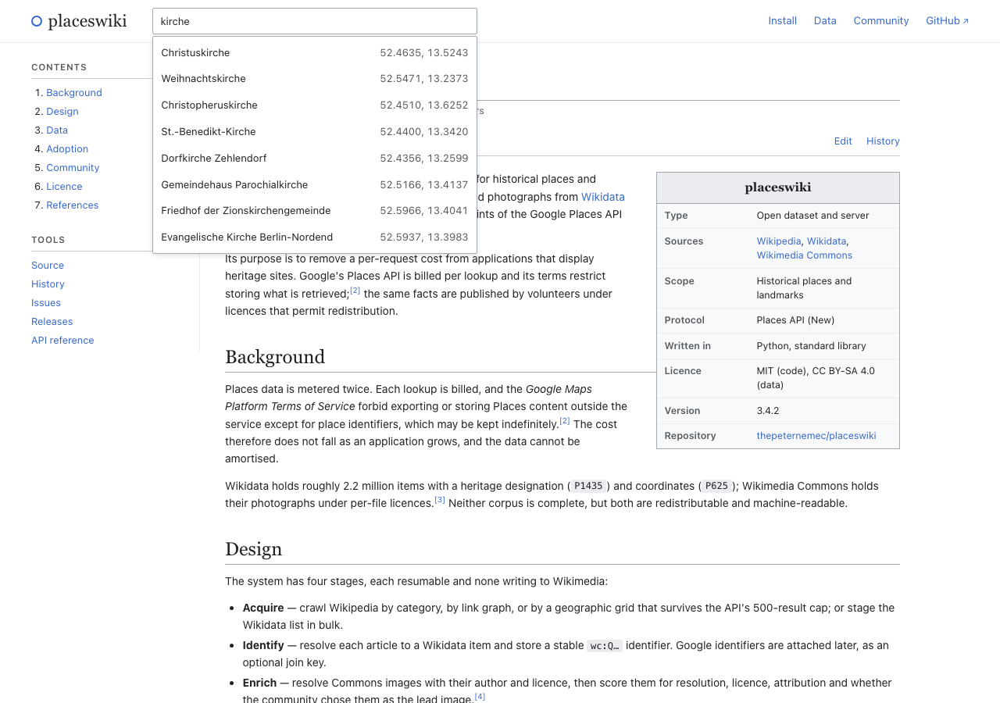
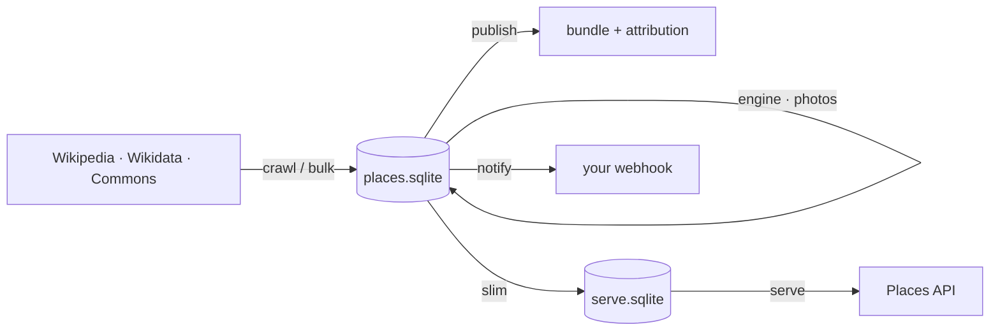

<div align="center">



[](https://github.com/thepeternemec/placeswiki/actions/workflows/ci.yml)
[](https://github.com/thepeternemec/placeswiki/releases)
[](LICENSE)
[](DATA-LICENSE.md)
[](pyproject.toml)

**A Places API you run yourself.** Historical places and landmarks from Wikimedia,
with coordinates, descriptions and photographs — served in the Google Places
protocol from your own server, with no per-request fees.

[Website](https://thepeternemec.github.io/placeswiki/) ·
[Quickstart](#quickstart) ·
[API](docs/API.md) ·
[Deploy](docs/DEPLOY.md) ·
[Integrate](docs/INTEGRATION.md) ·
[Contributing](CONTRIBUTING.md)

</div>

---

## Website

[**thepeternemec.github.io/placeswiki**](https://thepeternemec.github.io/placeswiki/) — the project
page, laid out like a Wikipedia article: contents sidebar, infobox, cited
references, a gallery from the Berlin sample, and a typeahead over its 899
places that works with no server and no framework (75 KB of JSON, 4 KB of
JavaScript, fetched only on focus).

[](https://thepeternemec.github.io/placeswiki/)

## Why

Google Places bills per request and forbids keeping what you fetched, so the cost
never falls as your product grows. The same facts — a church, its coordinate,
forty photographs of it — are already on Wikipedia and Wikimedia Commons under
licences that allow redistribution.

|  | Google Places | placeswiki |
| --- | --- | --- |
| Cost | per request | your server |
| Caching | time-limited | your file, your rules |
| Data | rented | CC BY-SA, redistributable |
| Scope | everything | heritage and landmarks |
| Identity | `ChIJ…` | `wc:Q…`, Google ids optional |

## Quickstart

```console
$ git clone https://github.com/thepeternemec/placeswiki && cd placeswiki
$ python3 examples/fixture_db.py data/places.sqlite      # or build 2.2M with `bulk`
$ docker build -t placeswiki .
$ docker run -d -p 8080:8080 -v "$PWD/data:/data" placeswiki
```

```console
$ curl -s localhost:8080/health
{"status": "ok", "places": 3, "photos": 2, "google_linked": 1}
```

No API key. No account. One SQLite file is the whole state.

## Use it

Your client already speaks this protocol. Change one line:

```js
const BASE = "https://places.yourdomain.com";   // was https://places.googleapis.com

const { places } = await (await fetch(`${BASE}/v1/places:searchNearby`, {
  method: "POST",
  headers: {
    "Content-Type": "application/json",
    "X-Goog-FieldMask": "places.id,places.displayName,places.location,places.photos",
  },
  body: JSON.stringify({
    locationRestriction: { circle: { center: { latitude: 46.0503, longitude: 14.5045 }, radius: 500 } },
    maxResultCount: 20,
  }),
})).json();
```

| Endpoint | Google equivalent |
| --- | --- |
| `POST /v1/places:searchNearby` | Nearby Search (New) |
| `POST /v1/places:searchText` | Text Search (New) |
| `GET /v1/places/{id}` | Place Details (New) |
| `GET /v1/{photo_name}/media` | Place Photo (New) |

Field masks, nested paths and error envelopes behave as they do upstream.
Details and deliberate differences: [docs/API.md](docs/API.md).

## What's inside

- **2.2 M places in the default heritage scope.** Every Wikidata item with a heritage
  designation and coordinates. Build with `--scope landmarks` to add notable bridges, parks,
  gardens, streets, roads, squares, monuments, memorials, statues, fountains, towers, castles,
  museums, churches, zoos, stadiums, lighthouses and archaeological sites, while restaurants,
  hotels, bars, pubs, shops, cafés, bakeries and nightclubs stay out.
- **Photographs that are scored, not scraped.** Resolution 40, licence 25, attribution 15, lead image 20 — with the reasons stored beside the score.
- **Stable Wikimedia ids.** `wc:Q10285` where Wikidata knows it; Google ids stay an optional join.
- **Webhooks.** Signed `dataset.updated` events after a build, so indexes refresh instead of polling.
- **Bundles you can verify.** Payload, photo index, generated attribution, SHA-256 per file.

## How it works



Acquire → identify → enrich → serve. Each stage is resumable, none writes to
Wikimedia, and every cap imposed by an upstream API is reported rather than
silently truncating.

## Docs

| | |
| --- | --- |
| [docs/API.md](docs/API.md) | endpoints, field masks, differences |
| [docs/DEPLOY.md](docs/DEPLOY.md) | Docker, Caddy, nginx, systemd, Fly/Render, sizing |
| [docs/INTEGRATION.md](docs/INTEGRATION.md) | JS/TS and Python clients, migration from Google |
| [docs/ARCHITECTURE.md](docs/ARCHITECTURE.md) | stages, layers, rules |
| [SCHEMA.md](SCHEMA.md) | field mapping to Places API (New) |
| [DATA-LICENSE.md](DATA-LICENSE.md) | what you may do with the data |

## Contributing

Corrections belong upstream: a wrong coordinate is wrong in Wikidata, a missing
author is missing on Commons. `placeswiki gaps` lists what is absent, with links.

Code follows [CONTRIBUTING.md](CONTRIBUTING.md). Tests run offline, no scraper is
accepted, and the project never writes to Wikimedia on its own.

---

<div align="center">
<sub><b>Built on the work of volunteers.</b><br>
Content by Wikimedia contributors · Identifiers by Google · Schema by placeswiki<br>
Code MIT · Text CC BY-SA 4.0 · Photographs per file</sub>
</div>
