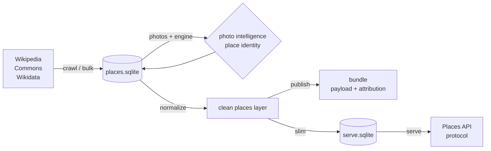

# Architecture

Four stages, one SQLite file, no service in the middle.

## Stages

| Stage | Module | What it guarantees |
| --- | --- | --- |
| Acquire | `crawl.py`, `wikidata.py`, `bulk.py` | opinionated pacing; resumable; honest about truncation |
| Identify | `engine.py` | every place gets a Wikimedia id, not a Google one |
| Enrich | `images.py`, `intel.py` | every photo has a licence, an author and a score |
| Serve | `schema.py`, `slim.py`, `serve.py` | Google's protocol, Google's envelopes |

## Two layers, on purpose

`pages` records what a wiki said, exactly as it said it. `places` is the
product: Places API field names, stable ids, no wikitext. Anything can be
rebuilt from provenance; nothing in provenance is ever rewritten by normalisation.

## Identity rules

- A place is `wc:Q…` when Wikidata knows it, `wc:<wiki>:<pageid>` otherwise.
- Google ids live in `place_links`, one primary per place, every candidate kept.
- Rejected matches stay in `google_matches` as evidence, not as noise.

## Photo rules

Scoring is explicit and explainable: resolution 40, licence 25, attribution 15,
lead image 20. The reasons are stored next to the score, so a client can answer
"why this photo?" without re-deriving anything.

## Failure rules

- Network work is retried with backoff and a `Retry-After` header respected.
- Anything capped by an upstream API is reported, not silently truncated.
- Every long job is resumable: `visited`, `wd_places.status`, photo keys.
- No stage writes to Wikimedia.

## Deliberate omissions

No image bytes, no ratings, no opening hours, no server-side cache, no accounts.
Each of those would turn a dataset into a platform.
